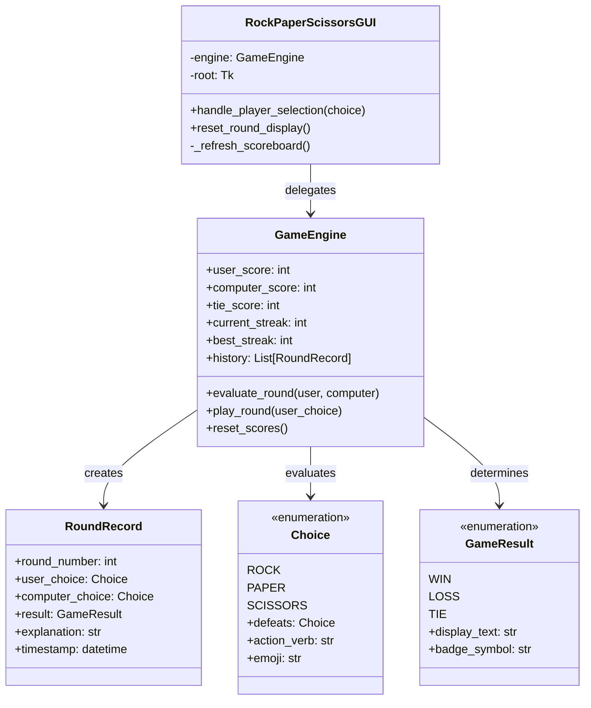

# 🪨 Rock-Paper-Scissors GUI — Professional Edition

[](https://www.python.org/)
[](https://docs.python.org/3/library/tkinter.html)
[](https://www.python.org/dev/peps/pep-0008/)
[](test_game_logic.py)
[](README.md#asset-specification)

A production-ready, interactive **Rock-Paper-Scissors** game crafted with Python and `tkinter`. Designed with modern aesthetic principles, decoupled domain architecture, real-time statistics tracking, dynamic showdown animations, and keyboard navigation.

---

## 📌 Asset Specification

- **Referenced Asset ID**: `3e548554-5bb7-4004-a613-8069b078f30e`
- **Application Identification**: CodSoft Python Development Internship — Task 3 (Rock-Paper-Scissors Game)

---

## 🌟 Key Features

1. **Intuitive & Responsive Graphical User Interface (GUI)**
   - Custom slate dark mode color scheme (`#0f172a`, `#1e293b`) with vibrant outcome highlights.
   - Large, accessible weapon selection buttons with emoji cues (`🪨 Rock`, `📄 Paper`, `✂️ Scissors`).
   - Dynamic showdown arena featuring real-time visual suspense cycling before revealing computer moves.

2. **Decoupled Architecture & PEP-8 Compliance**
   - Strictly separated domain logic (`game_logic.py`) from presentation (`gui.py`).
   - Complete type hinting (`from __future__ import annotations`, `typing`) and comprehensive docstrings.

3. **Robust Game Rules & Outcome Engine**
   - **Rock** crushes **Scissors**.
   - **Scissors** cuts **Paper**.
   - **Paper** covers **Rock**.
   - Identical choices result in a tie.
   - Descriptive feedback banners (e.g., *"Rock crushes Scissors! You score a point"*).

4. **Comprehensive Scoreboard & Analytics**
   - Player Wins, Computer Wins, and Tie counters.
   - Total Rounds played with dynamic user **Win Rate (%)**.
   - **Win / Loss Streak Tracking** (e.g., 🔥 3 Wins or ❄️ 2 Losses).

5. **Match Modes**
   - **Endless Casual**: Unlimited rolling play.
   - **Best of 3**: First to 2 wins triggers championship victory modal.
   - **Best of 5**: First to 3 wins triggers championship victory modal.

6. **Round History Modal**
   - Searchable, scrollable table detailing every round played in the current session with timestamps and explanations.

7. **Dual-Mode Execution (GUI + CLI Fallback)**
   - Run full GUI via `python main.py`.
   - Run headless or terminal version via `python main.py --cli` (ideal for remote servers or terminal enthusiasts).

---

## ⌨️ Keyboard Shortcuts

| Shortcut | Action |
| :--- | :--- |
| <kbd>R</kbd> | Choose **Rock** 🪨 |
| <kbd>P</kbd> | Choose **Paper** 📄 |
| <kbd>S</kbd> | Choose **Scissors** ✂️ |
| <kbd>Space</kbd> | Prepare / Reset next round duel display |
| <kbd>H</kbd> | View **Match History** modal |
| <kbd>Ctrl</kbd> + <kbd>R</kbd> | Reset all scores and session metrics |

---

## 🏗️ Architecture & Project Structure

```text
CODSOFT_TASKSNO_3/
│
├── game_logic.py         # Pure domain rules, Choice/GameResult enums, GameEngine
├── gui.py                # Tkinter graphical user interface, widgets, styles, dialogs
├── main.py               # Application launcher, CLI argument parsing, CLI fallback
├── test_game_logic.py    # Unit tests for domain engine rules, streaks, and scoring
├── test_gui.py           # Smoke and integration tests for GUI widget hierarchy
└── README.md             # Project documentation and specifications
```

### Class Responsibilities



---

## 🚀 Installation & Running

### Prerequisites
- Python 3.8 or later (Tested on Python 3.13).
- Tkinter library (included by default in standard Python distributions for Windows and macOS).
  - *On Debian/Ubuntu Linux, install via:* `sudo apt-get install python3-tk`

### Launch the GUI Application
```bash
python main.py
```

### Launch in Command-Line (CLI) Mode
```bash
python main.py --cli
```

### Check Version & Asset Tag
```bash
python main.py --version
```

---

## 🧪 Testing

Execute the automated test suite using Python's built-in `unittest` framework:

```bash
python -m unittest discover
```

All 8 unit and integration tests will execute, confirming rule logic, tie handling, score persistence, win streak calculations, and GUI component integrity.

---

## 📜 License & Compliance

Designed and developed for the CodSoft Python Internship Portfolio under standard MIT licensing principles. All code adheres to PEP-8 standards with complete type hints and descriptive docstrings.
